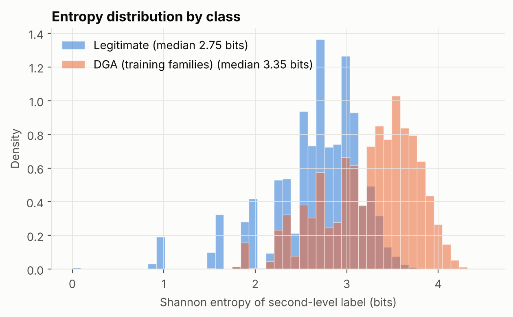
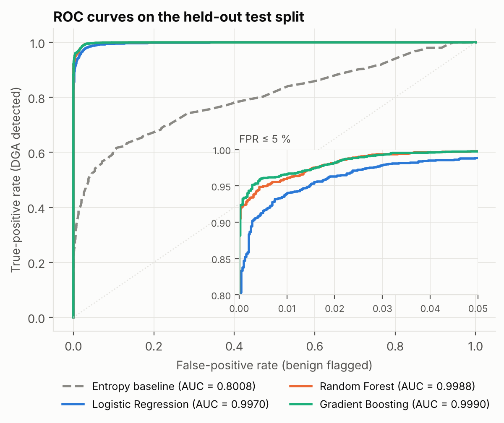
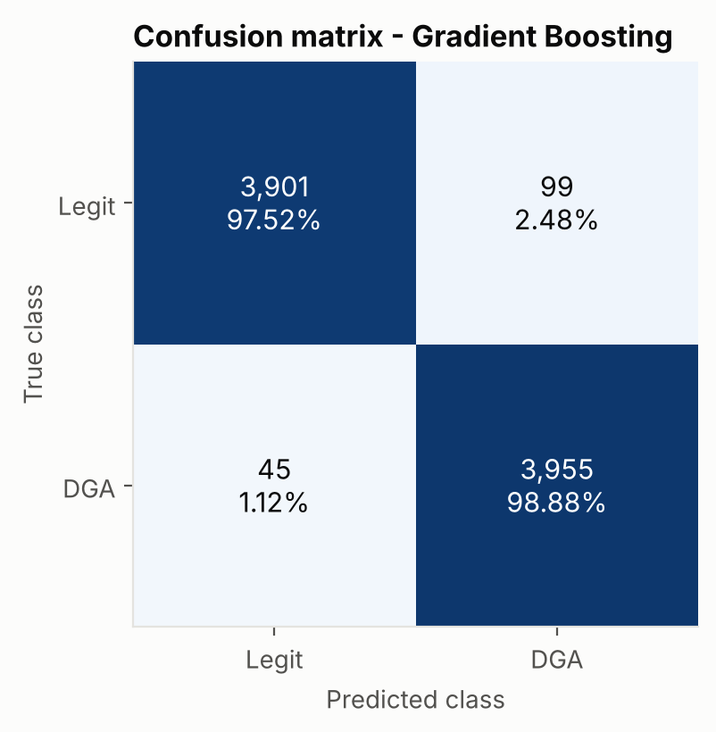
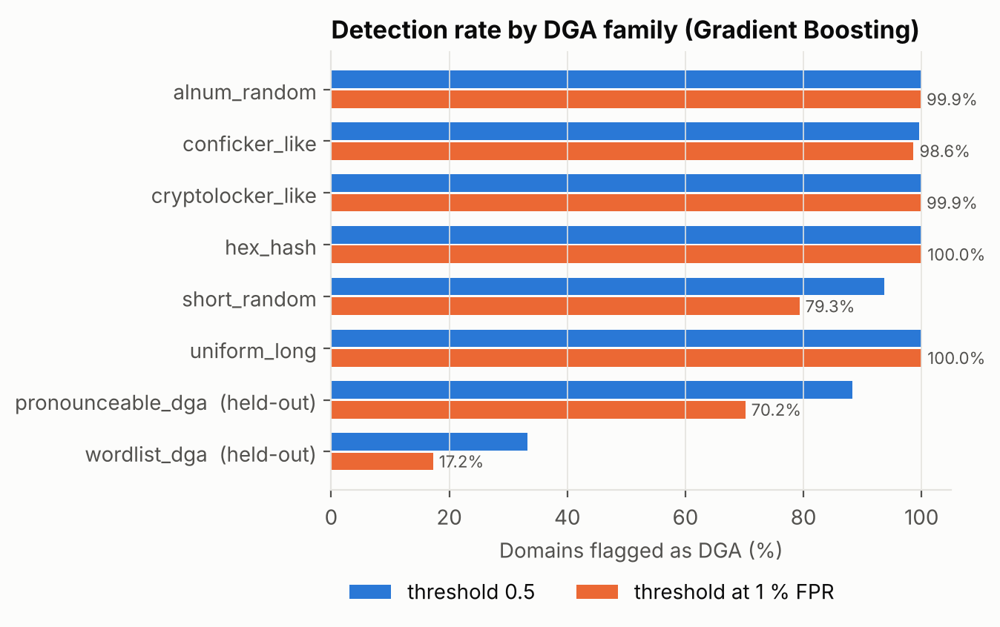
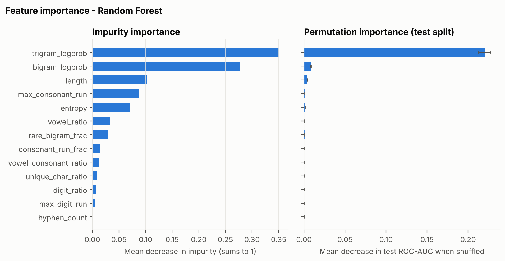

# Lexical Detection of Algorithmically Generated Malware Domains: A Reproducible Study with Classical Machine Learning

*dga-domain-detection project. All numbers in this paper come from
`python run_experiment.py` with seed 42; source data is in `results/`.*

---

## Abstract

Malware uses Domain Generation Algorithms (DGAs) to compute large, changing
lists of rendezvous domains for its command-and-control (C2) servers, which
defeats static domain blocklists. We study how far **lexical features
alone**, computed from the characters of a domain name, can separate DGA
domains from legitimate ones using lightweight scikit-learn models. We build
a fully synthetic, reproducible corpus of 40,000 second-level labels: 20,000
human-style benign names and 20,000 names from six date-seeded DGA families.
We also generate 4,000 names from two *held-out* evasive families. From each
label we extract 13 features: length, Shannon entropy, vowel and consonant
ratios, digit ratio, consecutive-consonant runs, and character bi-/tri-gram
rarity under a benign language model fitted inside the training pipeline. On
a stratified test split of 8,000 names, Gradient Boosting (selected by
cross-validated ROC-AUC) reaches **accuracy 0.9820, precision 0.9756,
recall 0.9888, F1 0.9821 and ROC-AUC 0.9990**. Random Forest is statistically
indistinguishable (F1 0.9823, ROC-AUC 0.9988), and both clearly beat a
classic entropy-threshold baseline (ROC-AUC 0.8008). At a 1%
false-positive-rate threshold calibrated on cross-validation scores, the
selected model detects 96.3% of test DGA domains at a realised test FPR of
0.825%. The n-gram rarity features carry most of the signal: removing them
lowers ROC-AUC to 0.9677. Generalisation to adversarial generators is poor,
though. Only **33.3%** of dictionary-word DGA names are flagged at the default
threshold (17.3% at 1% FPR), against 88.3% of pronounceable consonant-vowel
names. Lexical detection is an effective, cheap first filter against
random-looking DGAs, but it is not robust to adversaries who imitate benign
lexical statistics.

---

## 1. Introduction

Botnets and other malware must reach an attacker-controlled server to receive
commands and exfiltrate data. A hard-coded IP address or domain is a single
point of failure: once defenders block or sinkhole it, the malware is cut
off. Since Torpig's "domain flux" [7] and Conficker [8], many malware families
instead use a **Domain Generation Algorithm**. Bot and operator each run the
same seeded pseudo-random function (typically seeded with the current date)
to compute hundreds or thousands of candidate domains per day. The operator
registers only one or a few of them. The bot queries the list until one
resolves. Defenders face an asymmetric problem: blocking requires predicting
every candidate, while the attacker needs only one to succeed [1, 2, 15].
MITRE ATT&CK catalogues the technique as T1568.002 [17].

Because the infected host has to *resolve* candidate names, DNS is an
observation point that every DGA-based C2 channel passes through. The
cheapest signal available there is the name string itself. Random-looking
names such as `xjw3kq9vzt0p.biz` look nothing like human-chosen names such as
`cloudbank.com`. Lexical detection needs no registration data, no passive-DNS
history and no traffic aggregation, so it can run inline on every query at
microsecond cost.

This paper makes four contributions:

1. **A reproducible, download-free benchmark.** A documented synthetic
   generator of benign names and of date-seeded DGA families, including hard
   benign negatives (random-letter acronyms) and two held-out evasive DGA
   families.
2. **A leakage-safe lexical feature pipeline.** Thirteen interpretable
   features, including character n-gram rarity scored by a benign language
   model fitted *inside* the cross-validation loop.
3. **A comparison of four classifiers** (entropy baseline, logistic
   regression, random forest, gradient boosting) under 5-fold CV and a held-out
   test split, reporting accuracy, precision, recall, F1, ROC-AUC, confusion
   matrices and operating points at fixed false-positive rates.
4. **An evasion analysis.** Per-family detection rates, a feature-group
   ablation, and detection of unseen dictionary-word and pronounceable DGAs,
   which together show where lexical detection breaks.

## 2. Background

### 2.1 Command-and-control and domain generation

A C2 channel lets an operator command compromised hosts. Domain-based C2 is
attractive because DNS traffic is ubiquitous and rarely blocked outright. A
DGA is a function *f(seed, t) → {d₁, …, dₙ}* that both bot and operator
evaluate. Typical seeds are the date, a hard-coded constant, or, in some
families, public unpredictable data such as trending topics or exchange rates
[2]. Plohmann et al. [2] reverse-engineered 43 DGA families and classified
their generation schemes:

* **Arithmetic / random-character DGAs.** A PRNG indexes into an alphabet
  (e.g. Conficker, Cryptolocker, Necurs-style). The output is high-entropy and
  unpronounceable.
* **Hash-based DGAs.** The hex digest of a hash of the seed is used as the
  label (e.g. Bamital). The output is drawn from the alphabet `[0-9a-f]`.
* **Wordlist DGAs.** Words from an embedded dictionary are concatenated
  (e.g. Suppobox, Matsnu, Gozi). The output looks like benign compound names.
* **Permutation DGAs.** Variations of a base domain.

Conficker.C generated 50,000 candidate domains per day across 110 TLDs [8].
Volume like that makes pre-registration or blocklisting by defenders
impractical and drives research toward *detection* instead of enumeration.

### 2.2 Detecting DGA traffic

Detection approaches fall into three groups:

* **Contextual / behavioural.** Group NXDOMAIN responses by client and
  cluster them (Pleiades [1]), use passive-DNS reputation and time-series
  behaviour (EXPOSURE [9]), or track botnets across DGA campaigns
  (Phoenix [4]). These are powerful but need aggregation windows and
  infrastructure.
* **Lexical, feature-based.** Classify single names using hand-crafted
  string statistics. Yadav et al. [3] used distributions of unigrams and
  bigrams. FANCI [14] used 21 lexical features with random forests and SVMs on
  NXDomain traffic, reported high accuracy, and showed the method is cheap
  enough for large networks.
* **Lexical, featureless (deep learning).** Character-level LSTMs [5] learn
  representations directly from strings. DeepDGA [6] then showed that a GAN
  can generate domains that evade such detectors, and that retraining on
  adversarial samples restores some robustness.

This study deliberately stays in the second group with classical models. It
asks how much separation simple, explainable statistics provide, and where
their blind spots are.

### 2.3 Why lexical features work, and when they fail

Human-chosen names come from natural language and branding conventions. They
alternate vowels and consonants, reuse a small set of common character
transitions, and stay short. Uniform-random strings over an alphabet of size
*k* approach the maximum entropy log₂ *k* per character, contain long
consonant runs (21 of 26 letters are consonants), and use character
transitions that natural language rarely produces. The Shannon entropy
*H = −Σ p(c) log₂ p(c)* [13] of the character distribution is the classic
single-number summary. It has a known weakness: it is bounded by log₂(length),
so short random strings cannot have high entropy, and long benign compounds
can. Character n-gram language models capture the *ordering* of characters
that entropy discards. Any purely lexical method fails once the generator
imitates benign statistics, which is what wordlist DGAs and adversarial
generators [6] do.

## 3. Methodology

### 3.1 Synthetic data generation

All data is generated by `src/dga_detect/data.py` from a fixed seed (42).
Generation uses no network access and no external files. We use synthetic
data deliberately, so the study is self-contained and exactly reproducible.
Section 5.3 discusses the cost of this choice.

**Benign names (label 0, n = 20,000, unique).** Built from an embedded
vocabulary of about 400 common English and web words, using eight styles with
fixed probabilities:

| Style | p | Example |
|---|---|---|
| single word | 0.12 | `garden` |
| compound of 2 (15%: 3) words | 0.30 | `cloudbank`, `bluestoneriver` |
| prefix or suffix affix | 0.15 | `getmusic`, `travelhub` |
| hyphenated pair | 0.08 | `green-house` |
| invented pronounceable brand | 0.13 | `zolami`, `trakevon` |
| random acronym (2–5 letters) | 0.08 | `kfc`, `xdjtm` |
| word + number | 0.08 | `web365`, `24news` |
| vowel-dropped brand | 0.06 | `townblg` |

Acronyms are deliberate **hard negatives**. Real registries contain many
short, meaningless letter strings, and a lexical detector cannot separate
them from short random DGA output.

**DGA names, training families (label 1, n = 20,000).** Six families of
about 3,334 names each. Every family is a deterministic function of
(*family*, *date*, *salt*). A SHA-256 of these values seeds a 32-bit linear
congruential generator (multiplier 1664525, increment 1013904223), which
draws lengths and characters. Names are spread across the 365 days of 2026,
mirroring how a bot computes each day's rendezvous list.

| Family | Alphabet | Length | Inspired by |
|---|---|---|---|
| `short_random` | a–z | 5–8 | short-label DGAs |
| `conficker_like` | a–z | 8–11 | Conficker |
| `cryptolocker_like` | a–z | 12–18 | Cryptolocker |
| `uniform_long` | a–z | 19–28 | Necurs-style long labels |
| `alnum_random` | a–z, 0–9 | 10–20 | alphanumeric DGAs |
| `hex_hash` | 0–9, a–f (MD5) | 16–32 | Bamital-style hash DGAs |

**Held-out evasive families (label 1, n = 4,000).** These are never used for
training, model selection or threshold calibration.
`wordlist_dga` (2,000) concatenates 2–3 words from a 150-word vocabulary that
shares *no* words with the benign vocabulary (asserted by a unit test).
`pronounceable_dga` (2,000) generates 8–14 characters alternating consonant
and vowel.

Names that occur in both classes are removed from the DGA side, and held-out
names that collide with the main set are dropped. Benign labels have a mean
length of 8.46 characters (sd 2.95). DGA labels have a mean of 15.56 (sd
7.09). Each label receives a TLD for realism, but the TLD is **not** used as a
feature.

### 3.2 Lexical features

`DomainFeatureExtractor` is a scikit-learn transformer that maps a domain to
13 features computed on its lower-cased second-level label *s*:

| Feature | Definition |
|---|---|
| `length` | \|s\| |
| `entropy` | Shannon entropy of the character distribution of *s* (bits) |
| `vowel_ratio` | vowels / letters |
| `vowel_consonant_ratio` | vowels / (consonants + 1) |
| `digit_ratio` | digits / \|s\| |
| `unique_char_ratio` | distinct characters / \|s\| |
| `max_consonant_run` | longest run of consecutive consonants |
| `consonant_run_frac` | `max_consonant_run` / \|s\| |
| `max_digit_run` | longest run of consecutive digits |
| `hyphen_count` | number of `-` |
| `bigram_logprob` | mean log P(cᵢ \| cᵢ₋₁) under the benign character model |
| `trigram_logprob` | mean log P(cᵢ \| cᵢ₋₂cᵢ₋₁) under the benign character model |
| `rare_bigram_frac` | share of bigrams seen < 3 times in benign training names |

The **n-gram rarity** features score each name against a character language
model of *benign* names. Strings are padded with start (`^`) and end (`$`)
symbols, and conditional probabilities use add-one smoothing over a
39-symbol vocabulary. The model is fitted in `fit(X, y)` using only rows with
*y = 0*. Because the extractor is the first step of every scikit-learn
`Pipeline`, it is refitted on the training portion of every CV fold and of
the final training split, so the test split never contributes to the
reference model.

### 3.3 Models

All models are full pipelines that take raw domain strings as input
(`src/dga_detect/models.py`):

* **Entropy baseline.** Logistic regression on standardised Shannon entropy
  alone, a stand-in for the common "high-entropy name" SOC rule.
* **Logistic Regression (LR).** All 13 features, standardised, L2 penalty
  (C = 1).
* **Random Forest (RF)** [11]. 300 trees, `min_samples_leaf = 2`.
* **Gradient Boosting (GB)** [12]. scikit-learn's histogram-based gradient
  boosting, 300 iterations, learning rate 0.1.

### 3.4 Evaluation protocol

1. A stratified (by family) 80/20 split gives 32,000 training and 8,000 test
   names (4,000 per class in test).
2. 5-fold stratified CV on the training split. We record per-fold metrics
   and collect **out-of-fold** scores.
3. **Model selection** picks the highest mean CV ROC-AUC. The test split is
   never used for selection.
4. **Operating threshold.** For each model, the threshold that gives at
   most 1% FPR on the out-of-fold CV scores is applied unchanged to test and
   held-out data.
5. Each model is refitted on the full training split and evaluated once on
   test: accuracy, precision, recall, F1, ROC-AUC, confusion matrix, and
   TPR at 1% and 0.1% FPR.
6. Analysis: per-family detection rates, impurity and permutation feature
   importance (10 repeats, scored by ROC-AUC on test), a feature-group
   ablation with RF, and detection of the held-out families.

The full pipeline runs in **under 50 s** (46–49 s across runs) on a 4-core cloud container (Python 3.13,
NumPy 2.5.3, pandas 3.0.5, scikit-learn 1.9.1, matplotlib 3.11.2). Repeated
runs give identical results, apart from wall-clock timing columns.

## 4. Experiments and Results

### 4.1 Class separability at a glance

*Figure 1. Shannon entropy of the second-level label by class.*

The median entropy is **2.75 bits** for benign names and **3.35 bits** for
training-family DGA names. The distributions overlap heavily below 3.3 bits.
Short DGA labels (`short_random`, at most 8 characters) cannot exceed
log₂ 8 = 3 bits, and long benign compounds reach the same range. This overlap
explains why the entropy baseline is weak.

### 4.2 Main results on the test split

**Table 1. Test-split performance (n = 8,000; threshold 0.5).**

| Model | Accuracy | Precision | Recall | F1 | ROC-AUC | FPR | TN | FP | FN | TP |
|---|---|---|---|---|---|---|---|---|---|---|
| Entropy baseline | 0.7291 | 0.7251 | 0.7380 | 0.7315 | 0.8008 | 0.2798 | 2881 | 1119 | 1048 | 2952 |
| Logistic Regression | 0.9735 | 0.9660 | 0.9815 | 0.9737 | 0.9970 | 0.0345 | 3862 | 138 | 74 | 3926 |
| Random Forest | **0.9822** | **0.9784** | 0.9862 | **0.9823** | 0.9988 | **0.0218** | 3913 | 87 | 55 | 3945 |
| Gradient Boosting | 0.9820 | 0.9756 | **0.9888** | 0.9821 | **0.9990** | 0.0248 | 3901 | 99 | 45 | 3955 |

**Table 2. 5-fold CV on the training split (mean ± sd).**

| Model | Accuracy | Precision | Recall | F1 | ROC-AUC |
|---|---|---|---|---|---|
| Entropy baseline | 0.7301 ± 0.0037 | 0.7288 ± 0.0042 | 0.7331 ± 0.0040 | 0.7309 ± 0.0035 | 0.8053 ± 0.0027 |
| Logistic Regression | 0.9719 ± 0.0028 | 0.9613 ± 0.0043 | 0.9834 ± 0.0015 | 0.9723 ± 0.0027 | 0.9969 ± 0.0005 |
| Random Forest | 0.9825 ± 0.0012 | 0.9765 ± 0.0021 | 0.9887 ± 0.0008 | 0.9826 ± 0.0011 | 0.9988 ± 0.0002 |
| Gradient Boosting | 0.9822 ± 0.0012 | 0.9754 ± 0.0022 | 0.9894 ± 0.0025 | 0.9823 ± 0.0012 | 0.9988 ± 0.0001 |

Gradient Boosting was selected by mean CV ROC-AUC (0.99885 vs. 0.99879 for
RF). The difference is far smaller than one standard deviation, so we treat
the two tree ensembles as tied. Both beat the linear model on every metric,
and the CV estimates match test performance closely. All feature-based models
improve on the entropy baseline by a wide margin: +0.25 F1 and +0.20 ROC-AUC.

*Figure 2. ROC curves on the test split. The inset zooms into FPR ≤ 5%.*

*Figure 3. Confusion matrix of the selected model (Gradient Boosting).*

### 4.3 Operating points at low false-positive rates

A SOC budgets false alarms, so ROC-AUC on its own can mislead. Table 3
reports recall at fixed FPR.

**Table 3. Low-FPR operating points on the test split.**

| Model | TPR @ 1% FPR | TPR @ 0.1% FPR | Recall @ CV-calibrated 1%-FPR threshold | Realised test FPR at that threshold |
|---|---|---|---|---|
| Entropy baseline | 0.3555 | 0.2138 | 0.3835 | 0.0127 |
| Logistic Regression | 0.9400 | 0.8468 | 0.9272 | 0.0070 |
| Random Forest | 0.9605 | 0.9238 | 0.9595 | 0.0098 |
| Gradient Boosting | **0.9660** | **0.9338** | **0.9628** | 0.0083 |

The first two columns read the test ROC curve directly. The last two use the
threshold chosen on out-of-fold CV scores, which is the deployable setting.
That threshold transfers well: GB keeps 96.3% recall at a realised 0.825%
FPR. At 0.1% FPR, roughly one alert per thousand benign lookups, GB still
detects 93.4% of DGA names. The entropy rule detects only 21.4%.

### 4.4 Which DGA families are detected?

**Table 4. Detection rate per family (Gradient Boosting). For `legit` the
value is the false-positive rate.**

| Family | Split | n | Flagged @ 0.5 | Flagged @ 1%-FPR threshold |
|---|---|---|---|---|
| legit | test | 4000 | 0.0248 | 0.0083 |
| alnum_random | test | 667 | 1.0000 | 0.9985 |
| conficker_like | test | 666 | 0.9955 | 0.9865 |
| cryptolocker_like | test | 667 | 1.0000 | 0.9985 |
| hex_hash | test | 666 | 1.0000 | 1.0000 |
| short_random | test | 667 | 0.9370 | 0.7931 |
| uniform_long | test | 667 | 1.0000 | 1.0000 |
| **pronounceable_dga** | **held-out** | 2000 | 0.8825 | 0.7015 |
| **wordlist_dga** | **held-out** | 2000 | **0.3325** | **0.1725** |

*Figure 4. Detection rate by DGA family at two operating points.*

Long random, alphanumeric and hash-based families are detected almost
perfectly (≥ 98.6% at 1% FPR). Almost all of the remaining test error comes
from **`short_random`**, where 79.3% are detected at 1% FPR. The most
confident misses are short strings that happen to be pronounceable (`silun`,
`doxpe`, `cosud`, `goblo`). The most confident **false positives** are
random-letter acronyms (`xdjtm`, `xhlqw`, `xrhns`), a vowel-dropped compound
(`townblg`) and a digit-led name (`589sun`). With five or fewer characters,
"random" and "acronym" are lexically the same population.

The two **held-out** generators show the method's limits. Pronounceable
consonant-vowel strings are still mostly detected (88.3% at 0.5). Their strict
CV alternation and uniform letter choice produce trigrams such as `qew` and
`uwu` that are rare in benign names. **Dictionary-word DGAs evade the
detector:** only 33.3% are flagged at the default threshold and 17.3% at the
1%-FPR threshold, even though their vocabulary was never seen in benign
training data. Examples include `castlekernel` (score 0.0004) and
`ladderanvil` (0.0009).

### 4.5 Feature importance and ablation

*Figure 5. Random Forest impurity importance (left) and permutation
importance on the test split (right).*

By impurity, the forest relies mostly on `trigram_logprob` (0.351),
`bigram_logprob` (0.278), `length` (0.102), `max_consonant_run` (0.087) and
`entropy` (0.070). Permutation importance gives `trigram_logprob` almost all
the credit: shuffling it lowers test ROC-AUC by 0.220, versus 0.008 for
`bigram_logprob` and 0.004 for `length`. The two views differ because the
features are correlated. When one n-gram or length-related feature is
shuffled, its correlated partners still carry the information, so permutation
importance under-credits them, while impurity importance is biased in other
ways [16]. The standardised LR coefficients tell a consistent story. The
largest-magnitude weights are `max_consonant_run` (+6.03), `trigram_logprob`
(−5.76), `length` (−3.29), `consonant_run_frac` (−2.63) and `entropy`
(+2.06). Length gets a negative *conditional* coefficient because entropy and
consonant-run features already absorb its marginal association with DGAs.

**Table 5. Feature-group ablation (Random Forest).**

| Feature set | # | Test accuracy | Test F1 | Test ROC-AUC | Test FPR | wordlist_dga detected @ 0.5 | pronounceable_dga detected @ 0.5 |
|---|---|---|---|---|---|---|---|
| all features | 13 | 0.9822 | 0.9823 | 0.9988 | 0.0218 | 0.2020 | 0.7815 |
| structural only (no n-gram) | 10 | 0.9071 | 0.9049 | 0.9677 | 0.0690 | 0.1465 | 0.0050 |
| n-gram only | 3 | 0.9495 | 0.9504 | 0.9790 | 0.0695 | 0.0895 | 0.6520 |

Neither feature group is enough on its own. The three n-gram features beat
the ten structural ones on the test split (ROC-AUC 0.9790 vs. 0.9677).
Combining both cuts the FPR by a factor of three (6.9% → 2.2%). The ablation
also shows *why* pronounceable DGAs are caught. Structural statistics alone
detect only 0.5% of them, because their vowel ratios and consonant runs look
benign. The ordering information in the n-gram model is what flags them.
Neither group catches wordlist DGAs.

### 4.6 Cost

With batch scoring, a prediction including Python feature extraction costs
roughly 20–35 µs per domain (column `us_per_domain` in `results/metrics.csv`). Training on
32,000 names takes about 0.8–0.9 s (LR) to 2.0–2.1 s (RF). A lexical scorer is cheap
enough to evaluate on every DNS query at an enterprise resolver.

## 5. Discussion and Limitations

### 5.1 What the results mean

On random-character and hash-based generators, which still make up most of
the families catalogued in the wild [2], a dozen interpretable features and a
tree ensemble give detection above 96% at a 1% false-positive rate. Most of
the gain over the entropy heuristic comes from a **benign character language
model**. Entropy measures how spread out the characters are. The n-gram model
measures whether characters appear *in an order humans produce*, and that is
the more robust signal.

### 5.2 Evasion

The held-out experiments show the central weakness of lexical detection: the
adversary controls the generator, and the features describe properties the
adversary can choose.

* **Wordlist DGAs** (Suppobox, Matsnu, Gozi-style) produce names made of
  real words. Their character transitions are those of natural language, so
  `trigram_logprob` looks benign. We kept the DGA vocabulary *disjoint* from
  the benign one, and the detector still missed 67–83% of them depending on
  threshold. With a shared vocabulary, as when an attacker draws words from
  the same English dictionary that legitimate businesses use, lexical
  features cannot separate the classes even in principle.
* **Pronounceable generators** were caught here only because our toy
  generator alternates consonant and vowel rigidly and picks letters
  uniformly. A generator that samples from an English character Markov chain
  would match the benign n-gram model by construction.
* **Adaptive / adversarial generators.** DeepDGA [6] trains a GAN against a
  detector and produces names it cannot catch. Our features are differentiable
  in spirit and fully transparent (entropy, consonant runs, n-gram
  log-probabilities), which makes the optimisation target easy to find.
* **Length and short names.** Lowering the label length to 5–8 characters
  is a cheap evasion. The `short_random` family already loses about 20% of
  detections at 1% FPR, because short random strings collide with real
  acronyms.

**Defensive implications.** (i) Use lexical scores as a *triage* signal, and
combine them with context such as NXDOMAIN bursts per host, periodicity, and
domain age and registration data, as in [1, 9, 14]. (ii) Train with known
wordlist families and hard benign negatives, and expect to retrain as new
families appear. (iii) Monitor the score distribution of each client: one host
issuing many medium-score lookups is more suspicious than one high-score
lookup. (iv) Choose thresholds on held-out data at an explicit FPR budget, as
we do, not at 0.5.

### 5.3 Limitations of this study

* **Synthetic data.** Benign names come from a 400-word vocabulary and eight
  templates, not from a real popularity list such as Tranco [18]. Real benign
  traffic includes CDN and cloud hostnames (`d1x7k2…cloudfront.net`),
  tracking subdomains, IDNs/punycode and non-English names, many of which look
  random and would raise the FPR. The DGA families imitate generator *styles*
  and are not re-implementations of real malware. Absolute numbers should not
  be read as field performance. The *relative* findings are more likely to
  transfer: n-gram features beat entropy, short names and wordlist DGAs are
  hard, and the operating-point methodology is sound.
* **Template leakage.** Benign train and test names share templates and
  vocabulary, and each DGA family appears in both splits, so the test score
  measures in-distribution generalisation. The held-out families partially
  address this. A family-wise split (leave-one-family-out) would be a
  stricter protocol.
* **Second-level label only.** We ignore subdomains, TLDs and the
  public-suffix structure (e.g. `co.uk`). Production systems need a
  public-suffix parser.
* **Balanced classes.** Real DNS traffic is overwhelmingly benign. Precision
  at a 1:1 ratio overstates precision at deployment base rates, which is why
  we report TPR at fixed FPR. At 0.825% FPR and a 1:1,000 DGA:benign ratio, most
  alerts would still be false positives. Lexical scoring alone is not an
  alerting system.
* **No adversarial training or deep models.** By design, the study is
  limited to classical scikit-learn models and does not test robustness
  methods.

## 6. Conclusion

We presented a fully reproducible study of lexical DGA detection with
classical machine learning. Thirteen interpretable string features, dominated
by character n-gram rarity under a benign language model, let random forests
and gradient boosting separate synthetic DGA domains from human-style names
with F1 ≈ 0.982 and ROC-AUC ≈ 0.999, and detect 96% of DGA names at a 1%
false-positive rate. A classic entropy threshold reaches only ROC-AUC 0.80.
The same detector misses most dictionary-word DGA names (only 17–33%
detected), and short random names are lexically indistinguishable from real
acronyms. Lexical detection is a fast, cheap and explainable first filter
against random-looking generators. Against adversaries who imitate benign
lexical statistics it is not robust, and it should be combined with
behavioural and infrastructure signals. Future work: evaluate on real
benign/DGA corpora (Tranco and DGArchive), use leave-one-family-out splits,
add wordlist-aware features (dictionary segmentation scores, word-pair
co-occurrence), and stress-test adversarially with Markov-chain and GAN
generators.

## References

[1] M. Antonakakis, R. Perdisci, Y. Nadji, N. Vasiloglou, S. Abu-Nimeh,
W. Lee, and D. Dagon. "From Throw-Away Traffic to Bots: Detecting the Rise of
DGA-Based Malware." *USENIX Security Symposium*, 2012.

[2] D. Plohmann, K. Yakdan, M. Klatt, J. Bader, and E. Gerhards-Padilla.
"A Comprehensive Measurement Study of Domain Generating Malware." *USENIX
Security Symposium*, 2016.

[3] S. Yadav, A. K. K. Reddy, A. L. N. Reddy, and S. Ranjan. "Detecting
Algorithmically Generated Malicious Domain Names." *ACM Internet Measurement
Conference (IMC)*, 2010.

[4] S. Schiavoni, F. Maggi, L. Cavallaro, and S. Zanero. "Phoenix: DGA-Based
Botnet Tracking and Intelligence." *DIMVA*, 2014.

[5] J. Woodbridge, H. S. Anderson, A. Ahuja, and D. Grant. "Predicting Domain
Generation Algorithms with Long Short-Term Memory Networks."
arXiv:1611.00791, 2016.

[6] H. S. Anderson, J. Woodbridge, and B. Filar. "DeepDGA:
Adversarially-Tuned Domain Generation and Detection." *ACM Workshop on
Artificial Intelligence and Security (AISec)*, 2016.

[7] B. Stone-Gross, M. Cova, L. Cavallaro, B. Gilbert, M. Szydlowski,
R. Kemmerer, C. Kruegel, and G. Vigna. "Your Botnet is My Botnet: Analysis of
a Botnet Takeover." *ACM CCS*, 2009.

[8] P. Porras, H. Saïdi, and V. Yegneswaran. "An Analysis of Conficker's Logic
and Rendezvous Points." SRI International Technical Report, 2009.

[9] L. Bilge, E. Kirda, C. Kruegel, and M. Balduzzi. "EXPOSURE: Finding
Malicious Domains Using Passive DNS Analysis." *NDSS*, 2011.

[10] F. Pedregosa et al. "Scikit-learn: Machine Learning in Python." *Journal
of Machine Learning Research*, 12:2825–2830, 2011.

[11] L. Breiman. "Random Forests." *Machine Learning*, 45(1):5–32, 2001.

[12] J. H. Friedman. "Greedy Function Approximation: A Gradient Boosting
Machine." *Annals of Statistics*, 29(5):1189–1232, 2001.

[13] C. E. Shannon. "A Mathematical Theory of Communication." *Bell System
Technical Journal*, 27:379–423, 1948.

[14] S. Schüppen, D. Teubert, P. Herrmann, and U. Meyer. "FANCI: Feature-based
Automated NXDomain Classification and Intelligence." *USENIX Security
Symposium*, 2018.

[15] A. K. Sood and S. Zeadally. "A Taxonomy of Domain-Generation
Algorithms." *IEEE Security & Privacy*, 14(4):46–53, 2016.

[16] C. Strobl, A.-L. Boulesteix, A. Zeileis, and T. Hothorn. "Bias in Random
Forest Variable Importance Measures: Illustrations, Sources and a Solution."
*BMC Bioinformatics*, 8:25, 2007.

[17] MITRE ATT&CK. "Dynamic Resolution: Domain Generation Algorithms"
(T1568.002). https://attack.mitre.org/techniques/T1568/002/

[18] V. Le Pochat, T. Van Goethem, S. Tajalizadehkhoob, M. Korczyński, and
W. Joosen. "Tranco: A Research-Oriented Top Sites Ranking Hardened Against
Manipulation." *NDSS*, 2019.
